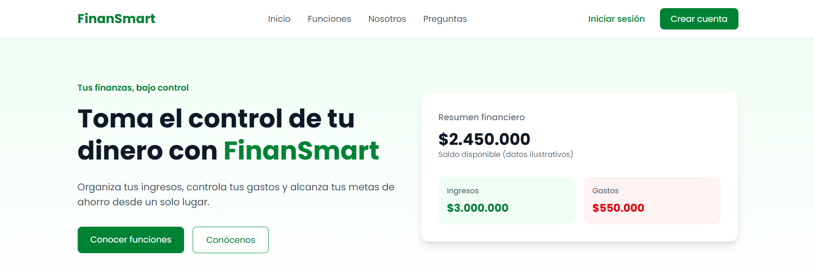
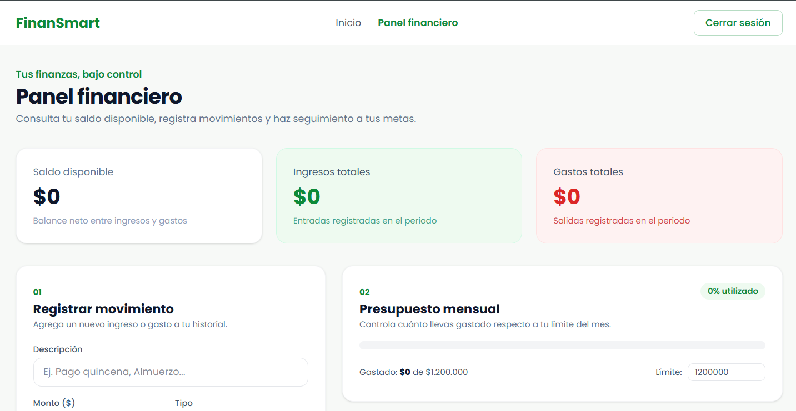

# 💸 FinanSmart

**Take control of your money from a single place.**

> 🌐 **Website:** [https://www.finansmart.app](https://www.finansmart.app)
>
> 🚀 **Project Type:** Personal Finance Management SaaS Platform.
>
> 📌 **Status:** Functional MVP in Production.

---

## 📖 About the Project

**FinanSmart** is a personal finance management web application designed to help students, young adults, freelancers, and working professionals organize and better understand their finances without needing advanced accounting knowledge.

Through a simple, visual, and intuitive web interface, each user can log into their personal account and centralize their daily money management to avoid disorganized spending and make it easier to achieve financial goals.

---

## ✨ What Does the Platform Offer?

Based on the core pillars of the product, **FinanSmart** integrates:

- **💰 Income & Expense Tracking:** Recording and deleting transactions linked to each user account, specifying the amount, date, category, and description.
- **📊 Monthly Budgets:** Setting monthly spending limits with percentage tracking and visual consumption alerts.
- **📈 Financial Statistics:** Charts and visual summaries comparing income versus expenses and breaking down spending by category (*food, transportation, housing, education, and entertainment*).
- **🎯 Savings Goals:** Setting financial targets with real-time tracking of the accumulated amount and percentage reached.

---

## 📸 Web Preview

### Main Screen & Financial Summary

### Financial Dashboard & Tools

---

## 🧭 Platform Sections

| Section | Purpose Within the Platform |
| :--- | :--- |
| **Home** | Main presentation featuring a preview of the financial summary (*available balance, income, and expenses*) and quick access links. |
| **Features** | Detailed showcase of the 4 key tools for financial organization and goal tracking. |
| **Sign Up & Login** | Account creation and login with persistent user session management. |
| **Financial Dashboard** | Private workspace where each user manages their transactions, budgets, category charts, and savings goals. |

---

## 🏗️ Architecture & Technologies

The **FinanSmart** tech ecosystem is built on a modern cloud web architecture:

- **Frontend:** *Next.js* (App Router), *React*, *TypeScript*, and *Tailwind CSS* for a dynamic and responsive interface.
- **Backend & API:** *Next.js Route Handlers* on *Node.js* with session-based authentication (`bcryptjs` and `httpOnly` cookies).
- **Database:** *PostgreSQL* on **Amazon RDS** via `pg` for relational storage of users, sessions, and account-isolated financial transactions.
- **Infrastructure & Deployment:** Custom domain with SSL (`www.finansmart.app`) and continuous cloud deployment.

---

## 👥 Development Team

| Member | GitHub |
| :--- | :--- |
| Christian Buitrón | [@Chris-1209](https://github.com/Chris-1209) |
| Melissa Prins | [@molywii](https://github.com/molywii) |
| Juan Saucedo | [@LilRocket2303](https://github.com/LilRocket2303) |
| Edwin Alcendra | [@dokylol2](https://github.com/dokylol2) |

---

## 📬 Contact

Have feedback or suggestions about **FinanSmart**? Feel free to reach out at **christianbuitron@outlook.com** or through the team's GitHub profiles.

---
